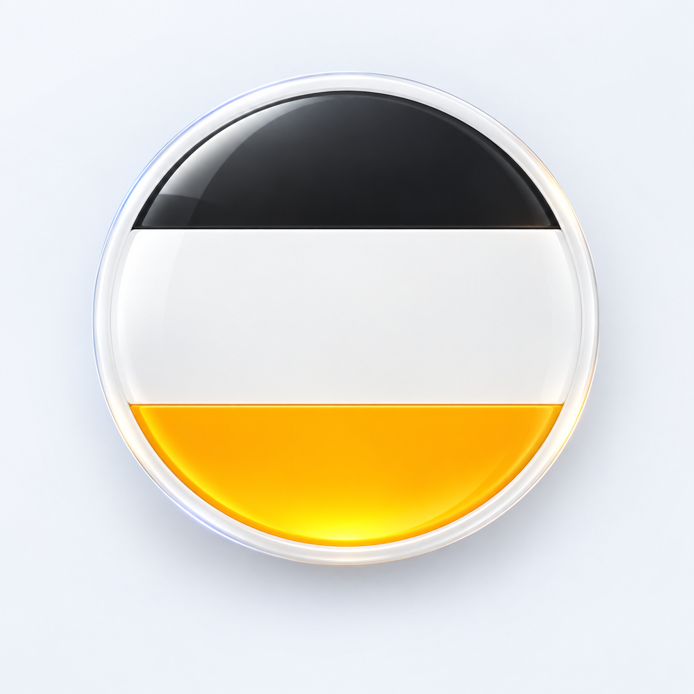
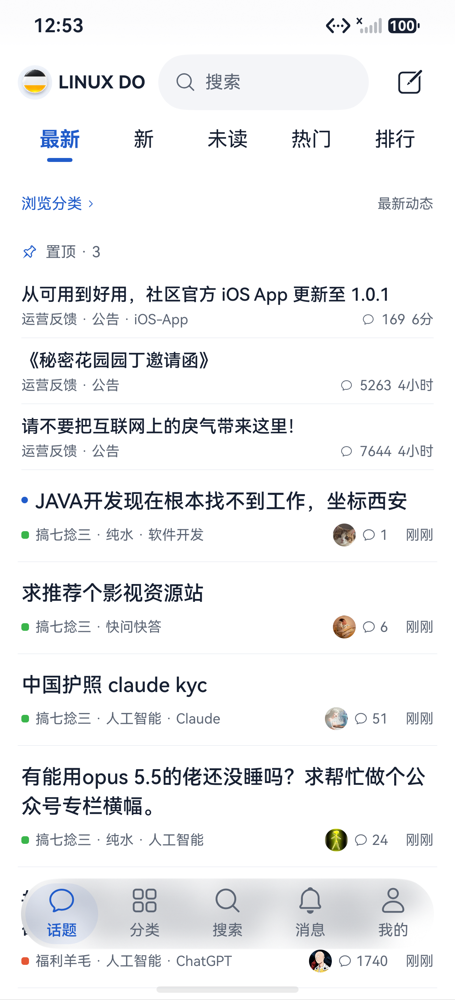
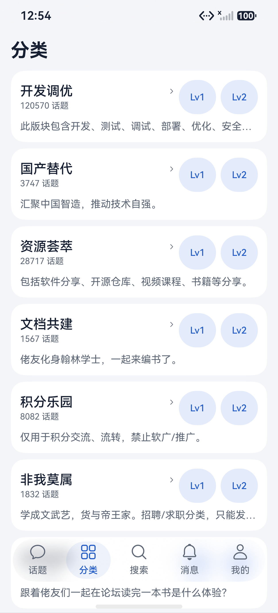
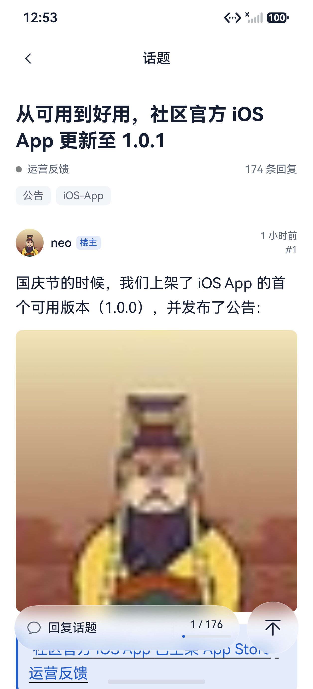
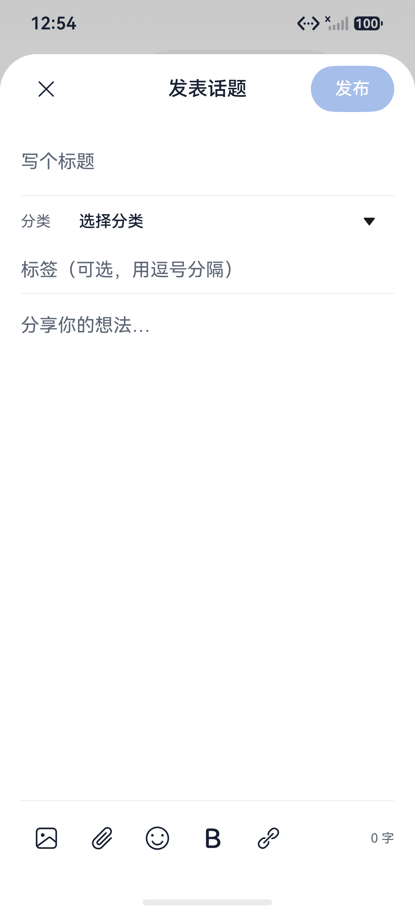
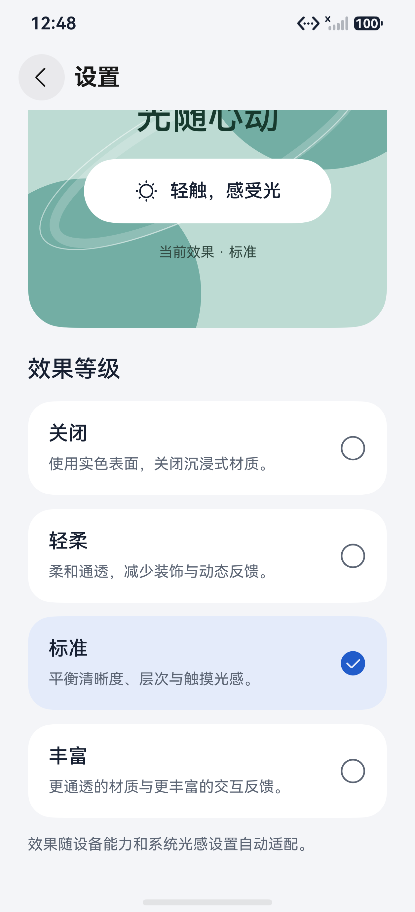
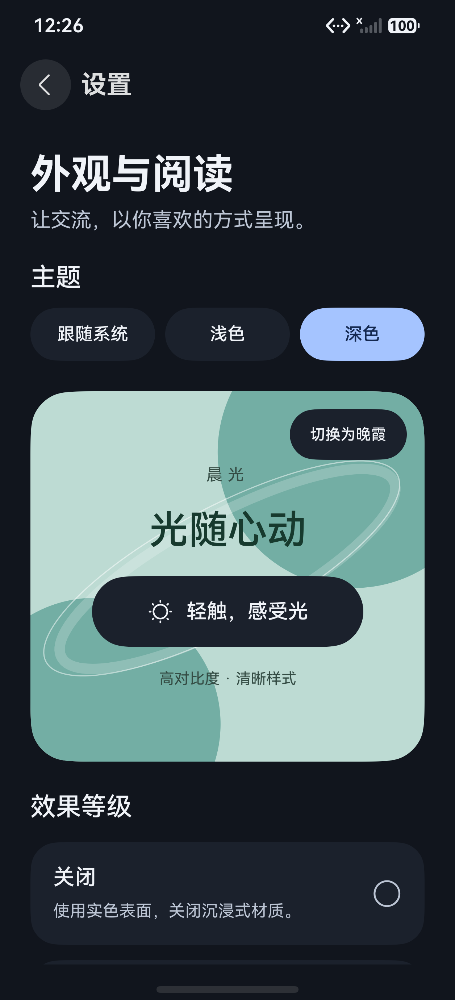

# LINUX DO Harmony · HarmonyOS NEXT 7

[](https://github.com/xyuuii/linuxdo-harmony/actions/workflows/logic-tests.yml)
[](LICENSE)
[](https://linux.do/)

社区开发的第三方 LINUX DO 客户端，也是 [xuemk/linuxdo-android](https://github.com/xuemk/linuxdo-android) 的鸿蒙功能衍生项目。感谢原作者 [xuemk](https://github.com/xuemk)；原介绍帖：[LINUX DO](https://linux.do/t/topic/2998703)。本仓库独立实现 ArkTS / ArkUI 原生页面与系统能力，公开源码采用 Apache-2.0。

A native HarmonyOS NEXT client for LINUX DO, inspired by xuemk/linuxdo-android. Built with ArkTS / ArkUI V2 and HarmonyOS 7 system materials.

基于 [xuemk/linuxdo-android](https://github.com/xuemk/linuxdo-android) 的真实功能与 Discourse 接口，以 ArkTS / ArkUI V2 重构的鸿蒙原生客户端。固定参考提交 `e31fe8e3a06a5de2e9c013925dd1c40a7743d30e`，源代码版本 1.1.1。

当前应用版本 `0.3.0`，包名 `com.xyuuii.linuxdo.harmony`，兼容及目标 SDK 均为 HarmonyOS 7 / API 26。

调试包：[0.3.0 GitHub Release](https://github.com/xyuuii/linuxdo-harmony/releases/tag/v0.3.0) · [下载 HAP](https://github.com/xyuuii/linuxdo-harmony/releases/download/v0.3.0/LinuxDo-HarmonyOS7-0.3.0-debug.hap) · [SHA256 校验文件](https://github.com/xyuuii/linuxdo-harmony/releases/download/v0.3.0/SHA256SUMS)。这是开发调试签名包，安装受签名设备授权限制；其他设备请按下方构建说明使用自己的开发者签名。二进制保存在 Release 附件中。

0.3.0 更新五入口导航、首页连续滑动分页、独立页面缓存、通知分类筛选及原生新建话题编辑器。布局参考官方 iOS 客户端与鸿蒙 IT之家，玻璃材质减淡并去掉多余投影；发布、草稿及键盘布局沿用鸿蒙原生交互。社区友链与项目来源见[社区与致谢](#社区与致谢)。

0.1.1 收紧首页、分类和搜索的信息密度：话题标题最多两行，缩小卡片留白；分类等级与名称同排。分类详情移除了重复标题和不适用的底部页签预留，列表用满可用高度。首页和搜索仅在滚动末端为浮动页签留空间。

0.2.0 重排帖子阅读页：作者与楼主标记在标题上方，主楼正文与图片铺满内容栏，回复改为连续列表，楼中楼以浅底区域呈现。底部固定“说点什么”入口和楼层导航；喜欢直接点按、其他回应长按选择，编辑/删除/简评/解决方案收在更多菜单。图片按原始宽高展示，长图有大预览；点开后黑底全屏，同楼层图片左右切换，支持双击和双指缩放、放大后平移，返回保持阅读位置。

0.2.1 参考实际手机上的酷安鸿蒙版阅读布局，引入作者/话题双行吸顶标题；初版由原生 NavDestination 的56vp标题栏承担。底部左侧“写回复”胶囊一次进入编辑器，右侧 HdsActionBar 提供楼层、回顶与收放控制。向下阅读时回复入口淡出收窄，右侧保留原生主按钮；反向滚动或点按可展开。移除常驻末尾留白，末尾继续上拉时才浮现带回顶入口的提示，松手弹回并保留约3.2秒后淡出。从尾部分页返回顶部会恢复真实首楼和标题，长首楼也可使用回顶。按钮接入系统沉浸材质，外观等级继续生效；减少动态效果时保持阅读操作栏展开并停止弹簧动效。

0.2.2 将窗口、四个主页面及帖子阅读区扩展到透明系统栏后方。系统区高度随窗口避让信息更新，内容首尾与操作控件各按所在边界避让一次。帖子使用含状态区的自绘模糊吸顶标题，保留原生页面返回语义；底部工具栏避开手势区；主导航保留独立毛玻璃背板与系统光感，减少动态时仍保留模糊。完整首批内容通过原生滚动边界平滑回顶，尾部分页仍先恢复真实首批楼层。键盘出现时窗口按 RESIZE 收缩，主导航隐藏。

0.2.3 去除状态区的灰色横条，以低强度模糊、少量主题色和原生 alpha 蒙版渐隐保持沉浸。写回复改为原生底部半模态，默认50%并可上拉到85%；图片、附件、表情、粗体和链接改为48vp图标工具，表情在面板内展开。键盘出现时选择较高档位并压缩内容，工具和发表按钮保留在键盘上方。草稿恢复完成前禁止写回，关闭确认保留，取消关闭不销毁编辑器。

0.2.4 为帖子底部的写回复与阅读操作增加独立毛玻璃背板，按效果等级提供真实背景模糊、主题染色、静态高光边缘和柔和阴影。按钮禁用或减少动态时仍保留可见背板；普通收起状态变为与原生主按钮圆心重合的52vp玻璃圆，原HdsActionBar宽度和动作保留。

0.2.5 按官方沉浸光感指南将阅读控件合并到单一材质容器，移除手绘渐变高光与子按钮的重复材质、阴影。真机沿用系统材质自带的模糊、边缘和阴影；当前API26模拟器报告支持但不绘制光学材质，使用均匀背景模糊与轻外阴影后备，避免出现内部灰带或完全透明。展开、收起、楼层、回顶及半屏回复已在模拟器验证。

0.2.6 将底栏触点流光与普通阴影分开。主导航与阅读工具共用一层材质容器，支持设备启用官方lightEffect，原生路径移除遮挡材质的后备模糊层；模拟器和不支持设备以真实触摸坐标驱动后备高光。光效跟随同一次按压跨按钮移动，松手或取消时消失；减少动态关闭弹性与转场，保留直接跟手高光，轻柔/关闭/高对比不启用光效。

0.2.7 修复真机底栏全透明：主导航和阅读操作统一使用可见的兼容玻璃层，将基础染色与背景模糊分开，触点流光独立跟随。Pura X View实测原生材质查询与构造成功仍无滤镜输出，因此浮动底栏不再依赖这一能力标志。系统设置未被修改，效果关闭及高对比仍使用实色。

0.2.8 新增首页双击已选“最新”回顶并刷新，普通单击切换页签仍立即响应；置顶话题集中为紧凑标题块，默认三条，可展开全部。帖子标题区域支持双击回顶，网站简评改为头像与内容胶囊；修复鸿蒙网络库拒绝空正文请求导致的点赞失败，喜欢操作提供服务器结果反馈，“我的 → 我点赞过”展示送出的喜欢，通知的“收到的赞”单独保留接收口径。底栏继续共用兼容玻璃与触点流光，调整通透层次；收起按钮可根据系统真实握持手状态靠向左侧或右侧，未知、双手或不支持时保留默认/上次明确侧别。

0.2.9 补充真实握姿诊断状态与前后台订阅日志，避免把保留的按钮位置当成当前识别结果。Pura X View已保留数据安装并验证首页回顶刷新、触点流光、简评、喜欢及撤销、半屏回复键盘与深浅色/高对比样式；系统握姿订阅成功并返回未握持，真实左右换手还待触发，不能用自动点击替代。

话题、分类、搜索、消息和我的使用 AdaptiveNavigationBar 五入口主导航，消息角标使用真实未读数。向下浏览时，同一个材质胶囊连续收拢为当前页图标按钮，默认靠右并可随明确握姿侧别调整；反向滚动或点击按钮连续展开。表面与图标节点保持，文字随收拢渐隐，五页阅读位置分别保留。开启减少动态效果或高对比时，主导航保持展开。主页面横滑切换关闭：首页左右滑动只切顶部最新/新/未读/热门/排行，底栏入口通过点击切换。

## 应用图标



0.1.2 以官网当前黑、白、黄橙三段圆形标志为参考，使用内置 ImageGen 生成玻璃边缘、柔和冷光与暖金折射质感，并接入桌面、启动页和关于页面。原始标志来源、生成方式及提示词见 [图标说明](docs/branding/icon-design.md)。

## 界面预览

0.3.0 当前界面（CodexPhone / HarmonyOS 7 模拟器，真实接口内容）：

| 首页与五入口 | 分类目录 |
| --- | --- |
|  |  |

| 公开帖子详情 | 新建话题 |
| --- | --- |
|  |  |

| 四档沉浸光感 | 深色与高对比 |
| --- | --- |
|  |  |

截图仅作界面展示，论坛内容权利归原作者。实际信息密度随设备、标题长度和字体设置变化。

## 功能

| 页面 / 流程 | 实现 |
| --- | --- |
| 话题 | 最新 / 新 / 未读 / 热门 / 本周排行；标题优先连续列表、分类与标签、头像、总回复数和时间；分页、下拉刷新、双击话题入口回顶刷新当前筛选、可展开置顶、前台可选自动刷新 |
| 分类 | 真实分类树、同名 Lv 子分类分组、按分类分页浏览 |
| 搜索 | 关键词、六种排序、结果摘要与分页 |
| 我的 | 总结、活动、我点赞过、通知、现有私信、账号与邮箱资料、退出 |
| 帖子详情 | 标题、分类/标签和总回复数在作者之前；原生安全富文本、可见楼层进度、前后 20 楼切片、首楼/尾部/指定楼定位、标题区域双击回顶、楼中楼三条预览及展开收起 |
| 互动 | 按服务器权限回复、编辑、删除、喜欢及其他回应与结果反馈、网站样式简评胶囊、解决方案标记 |
| 编辑器 | 首页右上角发帖；标题、可发分类、标签、正文、待审核回执；账号隔离的本机草稿、图库/文档选择器、4 MiB 附件校验、用户发表时才上传 |
| 图片 / 附件 | 同 UA / 会话的沙箱图片加载、原图查看、SaveButton 临时授权保存、系统文档保存 |
| 通知 | 全部 / 回复 / 收到的赞 / 私信；真实服务端 offset，点击已读，定位具体楼层；前台轮询与错误退避 |
| 登录 | 账号密码、邮件登录链接 token、TOTP / 恢复码、可见网页验证与第三方认证 |
| 外观 | 跟随系统 / 浅色 / 深色，四档沉浸光感，减少动态、高对比、树形阅读与设置持久化 |

启动时允许浏览服务器公开内容；私有内容与操作仍由服务器鉴权。新建话题仅列出当前账号明确可发的分类，发表前重查权限，使用社区正式发帖接口；私信仍查看现有会话。

## 鸿蒙 7 原生设计

使用 `HdsNavigation` 组织页面、`HdsTabs` 切换主页面内容。帖子在 `NavDestination` 内绘制固定的作者/话题双行标题：高度为动态顶部避让加56vp，启用单层系统背景模糊，关闭效果或高对比时使用实色。底部主导航由 AdaptiveNavigationBar 呈现。内容面板保持清晰，浮动主导航与阅读工具采用兼容背景模糊、主题染色与触点流光；设置控件和确认弹窗仍使用系统沉浸材质。预览中的背景是独立静态 SVG，通用控件原生材质使用 API 26 的 `uiMaterial.ImmersiveMaterial`，不将底栏兼容绘制称为原生光学渲染。

主导航常驻同一个材质 Stack 和五个稳定 key 的图标节点，由一个弹簧 progress 连续驱动表面宽高、位置、图标位移与文字透明度。HdsTabs 的 barHeight 为0，仅保留内容切换；收放由同一表面完成。首页顶部参考手机IT之家，固定品牌/搜索/发帖与文字标签，选中加粗及短下划线；标签不再使用整条玻璃胶囊，消息从底栏进入。内容采用原生Swiper连续跟手分页，拖动中同时显示当前页与邻页；五页分别保留内容、分页及滚动位置，预加载相邻页和点选目标。普通模式点击标签也有过渡，减少动态仍保留手指直接拖动。没有额外手写Pan与列表争抢手势。参考截图只保留在本机，未复制其它App的源码、图标或媒体资源。

握姿适配使用官方 `motion.on('holdingHandChanged')`，只依据系统明确的左手/右手结果调整收起按钮侧别，不根据触点、设备倾斜或模拟数据猜测。前台订阅、后台和销毁取消；未握持、双手和未知保持上次明确侧别，没有明确结果时默认右边。机型不支持返回801时保留布局，模拟器无法验证握姿硬件。实现依据[智感握姿最佳实践](https://developer.huawei.com/consumer/cn/doc/best-practices/bpta-smart-reach)及[获取用户动作指导](https://developer.huawei.com/consumer/cn/doc/harmonyos-guides/motion-guidelines)。

| 等级 | 通用控件系统材质 | 底栏兼容表面 |
| --- | --- | --- |
| 关闭 | 实色、`Material.empty` | 实色 |
| 轻柔 | `REGULAR`，无阴影/交互形变/触摸光感 | 模糊8，无投影、无触点流光 |
| 标准 | `REGULAR`、系统阴影、触摸光感 | 模糊12，无投影、触点流光 |
| 丰富 | `THIN`、系统阴影、形变及触摸光感 | 模糊16，无投影、触点流光 |

高对比覆盖材质选择。减少动态关闭控件形变及页签切换动画，并让主导航静态展开；标准/丰富等级保留直接随触点移动的高光，不加入自主循环动画，不宣称停止帖子 GIF。底栏在真机与模拟器上均保留可见染色、背景模糊与跟手高光，其他控件仍按原有能力回退。设备本身的 `getGlobalMaterialLevel()` 不可修改，本应用不会改变它。

启动时先获取主窗口并等待 `setWindowLayoutFullScreen(true)` 完成，再加载页面；任一步失败仍按默认布局继续加载，窗口布局失败只记录安全错误码。Index 通过 `@Env(SystemProperties.WINDOW_AVOID_AREA)` 获取以 vp 表示的动态避让信息：顶部取状态栏与挖孔高度的最大值，底部取手势指示条、系统栏与挖孔高度的最大值，不相加，也不把键盘高度计入系统栏避让。

Root / Navigation 负责扩展系统区，子 List / Refresh 不重复叠加 `ignoreLayoutSafeArea`。首页固定顶部承担 topInset，列表从0开始；分类仍使用负 topInset 的原生列表起点。消息列表保留独立滚动位置并为浮动底栏预留末端空间。状态区 EdgeBackdrop 使用只读的高斯背景模糊与主题渐隐：轻柔、标准、丰富的 radius 分别为3、5、7，以局部原生 alpha 蒙版一起渐隐到透明；关闭时取消模糊，高对比时使用实色；该层不响应触摸或交互光晕。Root 使用100%高度，普通页面采用 UIContext 的 `RESIZE`，键盘可见时隐藏主导航。半模态编辑器期间暂用 `OFFSET`，由 Sheet 自身的 `RESIZE_ONLY` 压缩输入内容；真正退场后恢复 `RESIZE`。

[华为设计规范](https://developer.huawei.com/consumer/cn/design/) · [HarmonyOS 7 / API 26 升级指导](https://developer.huawei.com/consumer/en/doc/harmonyos-releases/upgrade-adaptation) · [官方沉浸光感方案](https://developer.huawei.com/consumer/cn/doc/guidebook/solution-0000002784570841)

本轮还对照[沉浸光感最佳实践](https://developer.huawei.com/consumer/cn/doc/best-practices/bpta-spatiality-immersive)、[页签点击响应 FAQ](https://developer.huawei.com/consumer/cn/doc/doccenter-dev-faq/faqs-performance-20)及[IT之家鸿蒙版9.0官方介绍](https://www.ithome.com/1/003/407.htm)中的悬浮底栏与工具栏跟手展示。参考交互和层次，不复制素材，也不把兼容玻璃绘制称为已完整实测的原生光学效果。

## 登录与数据边界

- API / 原生桥只面向 `https://linux.do`，Cookie 从本应用 ArkWeb 读取，HttpOnly 可同步，密码和两步码不持久化。
- 原生请求禁止自动重定向。公共外域图片不带论坛 Cookie / CSRF。
- 网页认证精确允许当前站点展示的身份提供方，显示真实 origin。GitHub 跳转已在模拟器确认到 `github.com` 的真实登录页。
- 认证弹窗使用独立 controller / 原生面板，保留 POST、window.name 与 opener，子窗口不注册原生桥。
- 用户完成验证后才启用同源浏览器传输；不自动解验证码，也不自动重放写请求。
- 换账号立即取消旧请求、清显示数据和缓存；图片按账号、会话代数及进程隔离。
- 缺失编辑/删除/回复权限按不允许处理，提交前再次向服务器核实。写请求超时提示结果未确认，避免自动重复提交。
- 静态声明 `INTERNET` 和用于前台握姿感知的 `DETECT_GESTURE`，后者为普通级 `system_grant` 权限，不额外弹出动态授权；选文件走系统选择器，图片保存通过安全控件临时授权。

## 工程与构建

本机验证环境：DevEco Studio 26.0.0.821、HarmonyOS SDK 26.0.0.105 Release、DevEco CLI 1.3.0-stable、CodexPhone API 26 模拟器。

安装 DevEco Studio、HarmonyOS 7 / API 26 SDK 和 devecocli；完整 ArkTS / ArkUI 编译需要官方工具。随后：

```sh
git clone https://github.com/xyuuii/linuxdo-harmony.git
cd linuxdo-harmony
./scripts/build.sh
node --test tests/*.test.mjs
```

macOS 默认从 DevEco 的内置 TypeScript 路径执行测试；其他安装位置可设置 `DEVECO_TYPESCRIPT_PATH=/path/to/typescript/lib/typescript.js`。

在没有 HarmonyOS SDK 的机器上，仅执行离线逻辑测试：

```sh
npm install --prefix .local-test-runtime --no-save --package-lock=false --ignore-scripts typescript@4.9.5
DEVECO_TYPESCRIPT_PATH="$PWD/.local-test-runtime/node_modules/typescript/lib/typescript.js" node --test tests/*.test.mjs
```

离线回归读取实际生产方法，覆盖首页信号消费、刷新并发、置顶分组、喜欢反馈、简评展示与握姿生命周期等。GitHub Actions 使用 TypeScript 4.9.5 和 Node 22 执行同一测试集；测试只读取源码和编译运行时，不访问真实论坛或设备存储。它不编译 ArkUI、不登录论坛，不替代 SDK 编译及设备验收；各版本实际结果见[验收记录](docs/acceptance.md)。

本机 `app/build-profile.json5` 不进入 Git；仓库提供无凭据的 `build-profile.example.json5`，首次执行 build.sh 会复制模板。需要安装到自己的设备时，以自己的开发者账号生成包含目标设备的调试签名：

```sh
cd app
devecocli auth login
devecocli signature generate --product default
devecocli run --module entry --device CodexPhone
```

macOS 上如遇 CLI 把已有镜像误判未下载，可用 `./scripts/start-emulator.sh <已有实例名>` 调用官方底层 Emulator。脚本默认使用当前用户的镜像和实例目录，可通过 `DEVECO_STUDIO_CONTENTS`、`HARMONY_SYSTEM_IMAGE_ROOT`、`HARMONY_EMULATOR_INSTANCE_ROOT` 覆盖；只启动既有实例，不修改镜像 metadata 或清除 userdata。

## 验证

- 完整 SDK 编译、调试签名、安装、启动通过；模拟器 HDC 地址 `127.0.0.1:5555`，API 26 Release。
- 本地测试读取实际 .ets：响应映射、权限缺省、分页、通知口径、Unicode 简评、写 payload、401/403/429、取消、账号切换、图片隔离和认证域名。
- 已看到真实服务器最新话题，未使用模拟帖子填充应用。
- 0.2.1 的81项离线回归通过；当时的主导航收拢、点击展开与正文滚动已在模拟器观察。帖子末尾继续上拉反馈、尾部分页回首楼等阅读控制有模拟器记录与方法回归。
- Pura X View / HarmonyOS 7 真机用于观察酷安鸿蒙版7.1.1的实际交互；0.2.7本客户端的兼容底栏也有真机视觉记录。0.2.8逐项结果以验收记录为准，不将兼容视觉观察扩大为原生光学、握姿硬件或功耗验证。
- GitHub 认证入口已实测跳转成功；用户完成授权后，原生个人页确认会话有效，重启后仍可读取真实帖子。搜索“鸿蒙”已返回真实结果。
- 0.2.8在模拟器实测喜欢与撤销，并以Chrome回读确认恢复未赞；我点赞过可读到新记录。未发帖、上传、删除或改变通知已读状态。第二账号切换、握姿传感器及本轮物理设备光感仍未端到端验证，详见验收记录。
- `devecocli check lint` 当前返回 Files checked:0，不能作为 lint 有效通过；静态依据是 SDK 编译。
- SaveButton 调用 createAsset 的静态权限提示与官方临时授权场景对应，不为消除提示增加广域图库权限；相关文件/网络异常有释放和失败处理。

验证记录见 [docs/acceptance.md](docs/acceptance.md)。本机日志、账号界面、签名私钥和配置不随公开源码分发；调试签名安装包单独提供在 GitHub Release，其他开发者需使用自己的 SDK 和设备签名构建。

## 与 Android 版本的区别

- 页面和系统能力全部为鸿蒙原生；网页登录只用于身份认证/站点验证。
- 原 Android APK 版本源不用于鸿蒙更新。GitHub Release 提供手动下载HAP，应用内尚未接入自动更新或应用商店渠道。
- 原外部浏览器 RSA user-api-key 授权由本应用 ArkWeb 身份提供方登录和同源传输替代；没有注册 Android 的 discourse:// 授权回调。
- 保留源项目 track_visit=false，没有添加阅读计时上报，不承诺增加网站阅读活跃统计。
- Android 参考克隆只保留在本地 .reference，排除 Git 和交付包。公开仓库为独立鸿蒙实现，归属及许可范围见 [THIRD_PARTY.md](THIRD_PARTY.md)。

## 工程结构

- `app/entry/src/main/ets/pages/`：原生页面与导航。
- `components/`：话题列表、富文本、原生图片和材质预览。
- `models/`：论坛数据、会话及持久化外观设置。
- `services/`：论坛协议、网络/浏览器传输、媒体缓存与材质策略。
- `tests/`：读取实际 .ets 的离线 fixture。
- `scripts/`：构建入口和既有模拟器启动。

## 社区与致谢

本项目认可并支持 [LINUX DO 社区](https://linux.do/)，感谢社区提供的交流平台，以及佬友们的建议与反馈。

社区介绍与讨论：[LINUX DO 鸿蒙 NEXT 原生客户端 v0.3.0](https://linux.do/t/topic/3012205)。

特别感谢社区佬友 [@xmk2025](https://linux.do/u/xmk2025) 发布的[安卓原生客户端介绍帖](https://linux.do/t/topic/2998703)，以及 [xuemk/linuxdo-android](https://github.com/xuemk/linuxdo-android) 提供的功能与接口行为参考。鸿蒙版本使用 ArkTS / ArkUI 独立实现，具体来源与许可边界见 [THIRD_PARTY.md](THIRD_PARTY.md)。

本项目由社区成员维护，是第三方客户端；上述社区友链和致谢不表示 LINUX DO 官方认证或背书。

## 贡献与许可

贡献流程见 [CONTRIBUTING.md](CONTRIBUTING.md)，安全报告见 [SECURITY.md](SECURITY.md)。本仓库采用 [Apache License 2.0](LICENSE)，保留 [NOTICE](NOTICE) 中的第三方声明；原 Android 仓库在本次检查时没有声明许可证，本许可不覆盖其代码或资源。品牌、论坛内容与 SDK 的权利归各自所有者。
