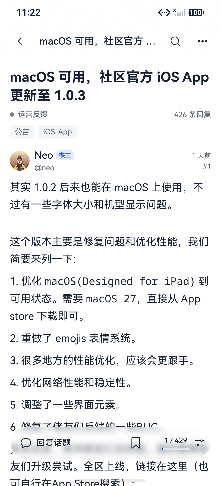
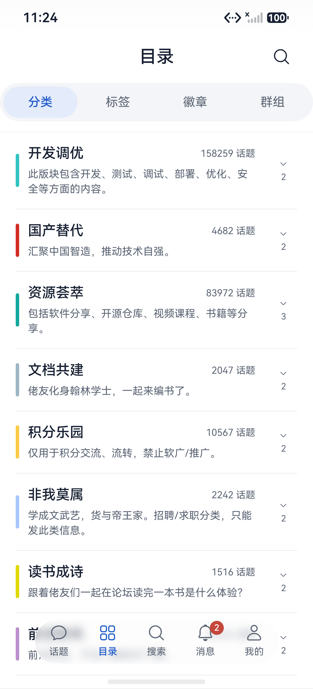
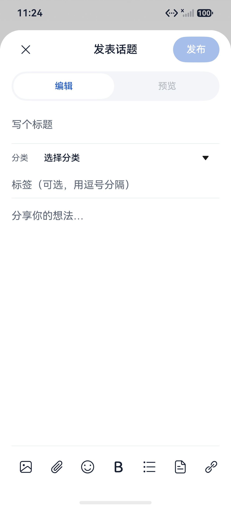

# LINUX DO Harmony

[](https://github.com/xyuuii/linuxdo-harmony/actions/workflows/logic-tests.yml)
[](LICENSE)
[](https://linux.do/)

用鸿蒙原生界面逛 [LINUX DO](https://linux.do/)。支持 HarmonyOS 7，第三方社区客户端。

[界面预览](#界面预览) · [下载安装](#下载安装) · [更新记录](docs/changelog.md) · [社区讨论](https://linux.do/t/topic/3012205)

## 0.4.1 更新

- **阅读更紧凑**：昵称与用户名分层，简评紧跟正文，多段引用合并成卡片。
- **找帖更方便**：分类、标签、排序和排行时段筛选；最近搜索、高级筛选和话题内搜索。
- **目录更完整**：分类、标签、徽章、群组四个入口，分类支持查找和展开子分类。
- **个人内容集中查看**：收藏、本机草稿、话题、回复，以及投票、方案和 Boost 记录入口。
- **阅读操作集中**：回复、收藏、楼层进度合并在底部胶囊；补充用户资料、引用、分享和通知设置。

[下载 0.4.1 预览版](https://github.com/xyuuii/linuxdo-harmony/releases/tag/v0.4.1) · [完整功能与验证范围](docs/ios-parity.md)

## 界面预览

0.4.1 · CodexPhone / HarmonyOS 7 模拟器 · 2026-10-30 重新截图。使用 edge 联网试验包读取真实公开内容；模拟器画面不代表真机光学材质效果。

| 首页筛选 | 帖子阅读 |
| --- | --- |
|  |  |

| 四类目录 | 原生编辑器 |
| --- | --- |
|  |  |

[查看全部新版截图与功能介绍 →](docs/screenshots/README.md)

截图仅展示客户端界面，论坛内容权利归原作者。

## 下载安装

**[0.4.1 预览版](https://github.com/xyuuii/linuxdo-harmony/releases/tag/v0.4.1)**：

[普通 HAP](https://github.com/xyuuii/linuxdo-harmony/releases/download/v0.4.1/LinuxDo-HarmonyOS7-0.4.1-debug.hap) · [edge DoH/ECH 试验 HAP](https://github.com/xyuuii/linuxdo-harmony/releases/download/v0.4.1/LinuxDo-HarmonyOS7-0.4.1-edge-ech-trial-debug.hap) · [SHA256 校验](https://github.com/xyuuii/linuxdo-harmony/releases/download/v0.4.1/SHA256SUMS)

需要 **HarmonyOS 7 / API 26**。调试包受签名设备授权限制，其他设备需使用自己的开发者签名构建。两个包同包名，覆盖切换，不能并装。

试验包的网络适用范围见 [ECH 说明](experiments/ech-probe/README.md)；不保证所有网络直连或长期免验证。

## 日常功能

| 场景 | 可以做什么 |
| --- | --- |
| 浏览 | 最新、新、未读、热门、排行；连续分页，分类与标签浏览 |
| 阅读 | 楼中楼、楼层跳转、引用展开、原图缩放、图片与附件保存 |
| 互动 | 按服务器权限回复、编辑、喜欢、简评、收藏和举报 |
| 编辑 | 原生编辑器、图片与附件、表情及格式工具、主动预览、本机草稿箱 |
| 消息 | 全部、回复、收到的赞、私信筛选；未读角标与楼层定位 |
| 外观 | 跟随系统、浅色、深色；四档沉浸光感、减少动态、高对比及阅读偏好 |

目前草稿仅保存在本机；私信可查看已有会话。站内聊天、后台系统推送、完整投票交互、收藏提醒及云端草稿同步尚未完成。详情见 [已实现与待补齐功能](docs/ios-parity.md)。

## 自行构建

安装 DevEco Studio、HarmonyOS 7 / API 26 SDK 和 devecocli 后：

```sh
git clone https://github.com/xyuuii/linuxdo-harmony.git
cd linuxdo-harmony
./scripts/build.sh
node --test tests/*.test.mjs
```

[签名与安装、离线测试](docs/development.md#工程与构建) · [鸿蒙原生设计](docs/development.md#鸿蒙-7-原生设计) · [登录与数据边界](docs/development.md#登录与数据边界) · [验收记录](docs/acceptance.md)

## 社区与致谢

本项目认可并支持 [LINUX DO 社区](https://linux.do/)。感谢 [@xmk2025 的安卓客户端介绍](https://linux.do/t/topic/2998703) 与 [xuemk/linuxdo-android](https://github.com/xuemk/linuxdo-android) 提供功能及接口行为参考；鸿蒙版本使用 ArkTS / ArkUI 独立实现。

项目为第三方社区作品。来源与许可边界见 [THIRD_PARTY.md](THIRD_PARTY.md)，图标生成方式见 [图标说明](docs/branding/icon-design.md)。

## 贡献与许可

[贡献指南](CONTRIBUTING.md) · [安全报告](SECURITY.md) · [Apache-2.0](LICENSE) · [第三方声明](NOTICE)

品牌、论坛内容与 SDK 的权利归各自所有者；本项目许可不覆盖原 Android 仓库的代码或资源。
