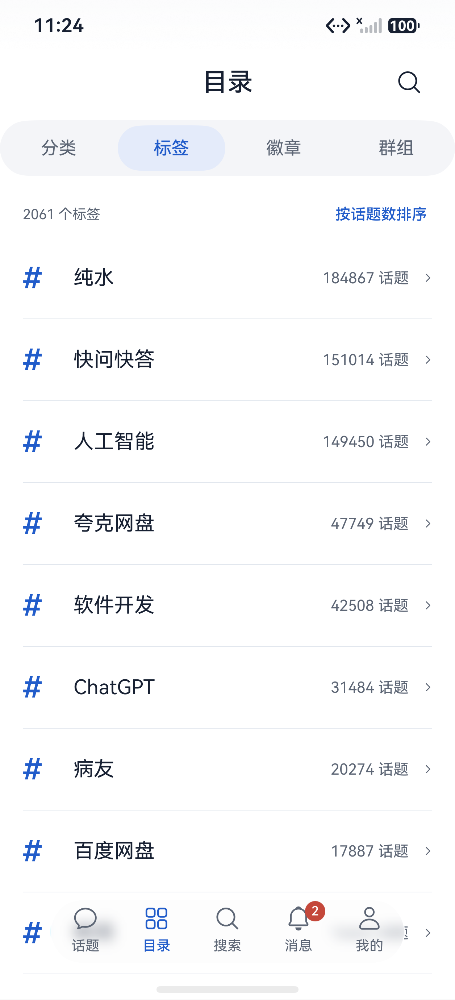
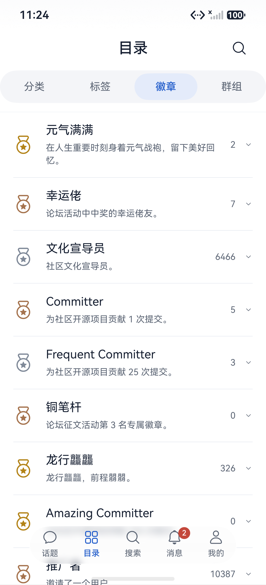
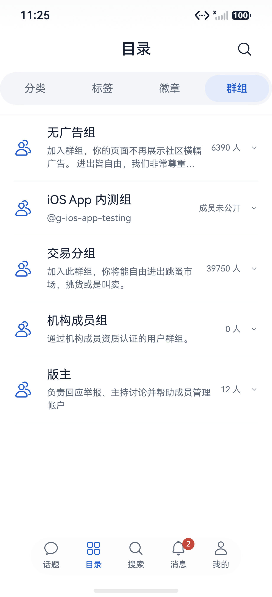
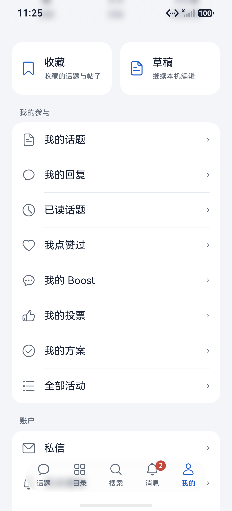
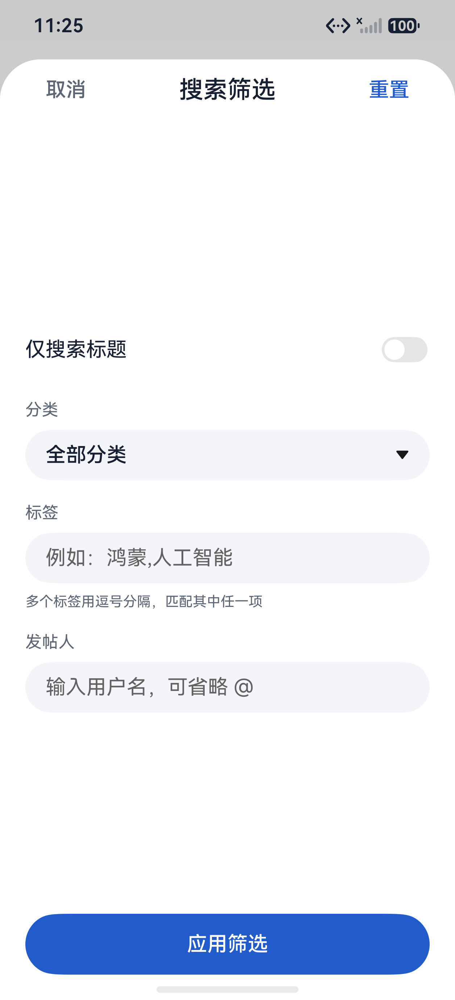
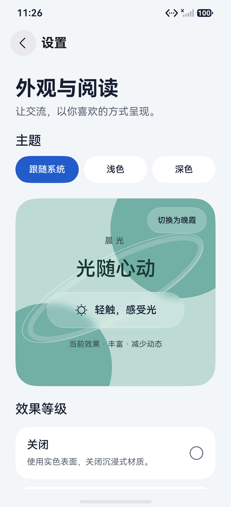
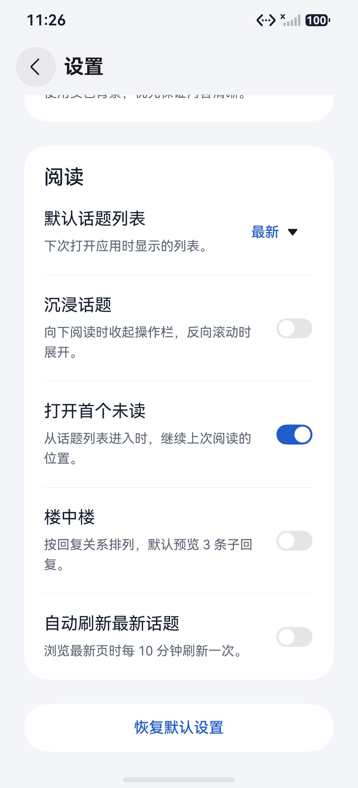

# 0.4.1 界面与功能

[返回项目首页](../../README.md) · [下载安装](https://github.com/xyuuii/linuxdo-harmony/releases/tag/v0.4.1)

2026-10-30 在 CodexPhone / HarmonyOS 7 模拟器重新截图。使用 0.4.1 edge 联网试验包读取真实公开内容；个人页仅展示功能入口。截图不代表全部服务端操作或真机光学材质已通过验收。

## 首页与阅读

分类和标签可以组合筛选；阅读页把回复、收藏和楼层进度放进同一个底部胶囊。

| 首页 · 分类与标签筛选 | 阅读 · 作者信息与操作栏 |
| --- | --- |
|  |  |

## 分类与标签

目录重排为分类、标签、徽章、群组四个入口。分类可查找和展开，标签可排序并进入话题列表。

| 分类目录 | 标签目录 |
| --- | --- |
|  |  |

## 徽章与群组

补充徽章说明和群组目录。群组成员、加入退出与徽章获得者等深入流程仍待补齐。

| 徽章目录 | 群组目录 |
| --- | --- |
|  |  |

## 个人入口与搜索

收藏、本机草稿和参与记录集中查看；搜索支持仅标题、分类、标签和发帖人筛选，并保留最近搜索。

| 我的 · 收藏、草稿与参与记录 | 搜索 · 常用筛选 |
| --- | --- |
|  |  |

## 编辑与回复

原生编辑器提供格式工具和主动预览；阅读页重新整理昵称、用户名、简评与操作行。草稿只保存在本机。

| 新话题 · 空白编辑器 | 回复 · 紧凑版式 |
| --- | --- |
|  |  |

## 外观与阅读偏好

支持主题、四档沉浸光感与无障碍设置，新增默认列表、沉浸话题和打开首个未读等阅读偏好。

| 外观设置 | 阅读偏好 |
| --- | --- |
|  |  |

所有论坛内容权利归原作者。聊天、后台系统推送、云端草稿同步和完整投票等尚未完成，详见 [功能与验证范围](../ios-parity.md)。
